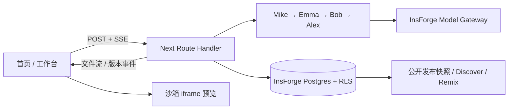

# Atoms Lite

用一句话生成可运行的 HTML/CSS/JS 应用。Mike 分派需求，Emma 整理产品要求，Bob 规划文件，Alex 编写代码；过程流式展示，支持继续修改、历史版本、运行错误修复和公开发布。

**[在线体验](https://53bg3mbj.insforge.site) · [GitHub](https://github.com/nomorekuiqian/atoms-demo) · [验收记录](docs/RELEASE-2026-10-10.md)**

登录页点击 **Try the demo account**，无需输入密码。共享体验账号中的修改对所有体验者可见；需要独立项目可自行注册。


## 示例应用

以下三个应用均由真实模型生成，并在无登录浏览器中验收。数据保存在访问者自己的浏览器。

- [番茄钟](https://53bg3mbj.insforge.site/p/my-pomodoro)：开始、暂停、重置和今日完成次数。
- [记账本](https://53bg3mbj.insforge.site/p/expense-tracker)：分类、月度合计、新增/删除、刷新保留。
- [贪吃蛇](https://53bg3mbj.insforge.site/p/snake-classic)：键盘或手机方向按钮、暂停、高分记录。


## 技术与运行模式

Next.js 15 App Router / TypeScript / Tailwind CSS **3.4** / Radix + shadcn 风格组件 / Zustand / Vitest。InsForge 提供 Postgres、Auth、RLS、Model Gateway 与 Sites 托管。

生产使用 **真实 Claude Haiku 5.5**（四个角色均使用 `anthropic/claude-haiku-5.5`），`LLM_MOCK=0`。本地默认回放 fixture，不消耗 AI 额度。Mock 是固定录制结果，无法证明任意需求或错误真的被解决。



编排器 `lib/agents/` 不依赖 Next.js。新应用走四角色；小改动走 Mike→Alex；Resolve 将错误上下文交给 Alex。

## 本地运行

需要 Node 22、npm，以及自己有权访问的 InsForge 项目。**Mock 只替代模型，不替代数据库和认证。**

```bash
git clone https://github.com/nomorekuiqian/atoms-demo.git
cd atoms-demo
npm ci
cp .env.example .env.local
# 填入自己项目的 URL、anon/admin key、体验账号；保持 LLM_MOCK=1
npm run dev
```

新后端需登录并连接 InsForge 后执行：

```bash
npx -y @insforge/cli db migrations up --all
npx -y @insforge/cli config apply
```

体验账号需先在对应后端注册，再将邮箱/密码填入服务端变量。切勿将本项目生产凭据复制到公开文档。

| 变量 | 用途 |
|---|---|
| `NEXT_PUBLIC_INSFORGE_URL` / `NEXT_PUBLIC_INSFORGE_ANON_KEY` | 公开 SDK 配置；数据受 RLS 保护 |
| `INSFORGE_API_KEY` | 服务端管理凭据，用于发布 / Discover / Remix |
| `OPENROUTER_BASE_URL` / `OPENROUTER_API_KEY` | InsForge 网关或自有 OpenRouter；服务端专用 |
| `OPENROUTER_CHAT_MODEL` | Alex；默认 Haiku 5.5 |
| `OPENROUTER_FAST_MODEL` | Mike / Emma / Bob；默认 Haiku 5.5 |
| `LLM_MOCK` | 本地 `1` 回放 `fixtures/*.json`；生产 `0` |
| `DEMO_EMAIL` / `DEMO_PASSWORD` | 一键体验登录，密码不送到浏览器 |
| `DAILY_LIMIT` / `DAILY_LIMIT_DEMO` | 默认普通账号 30、共享体验账号 10 次/UTC 日 |
| `RECORD_FIXTURES` | 可选，本地设 `1` 允许录制；生产禁用 |
| `NEXT_DIST_DIR` | 可选，本地多个服务使用独立构建目录 |

```bash
npm run typecheck
npm run lint
npm run test
npm run build               # 每次部署前必须通过
npm run deploy
```

真实接口冒烟会消耗额度；仅在需要时执行：

```bash
node --env-file=.env.local scripts/smoke-generate.mjs "Build a small timer" --app http://localhost:3000
node --env-file=.env.local scripts/check-rls.mjs http://localhost:3000
node --env-file=.env.local scripts/check-publish.mjs http://localhost:3000
```

后两项创建并清理临时项目，RLS 检查还会注册测试账号。生成脚本是否真实调用取决于目标服务的 `LLM_MOCK`，不是调用者本地环境。

## 功能与验收

| 范围 | 状态 |
|---|---|
| F1–F9：账号、项目、四角色流式生成、代码、预览、迭代、保存、发布 | 已实现、线上验收 |
| E1：查看历史 / Restore / Revert | 已实现，Restore 另存新版本 |
| E2：Issue Report / Resolve | 真实报错→Resolve→原按钮再次点击无报错 |
| E3：Discover / Remix | 已实现，复制发布代码，不复制对话 |
| E6：5 个主题预设 | 已实现，Paper/Midnight 真实对照验证 |
| M6：明暗、375px、加载/错误、断网重试 | 已检查，主站浏览器无未处理异常 |
| M7：真实模型、3 个示例、文档、交付回归 | T1–T13 通过；完整证据见发布记录 |

T1 首页、T2 注册、T3 连续三次真实生成、T4 Code、T5 迭代、T6 恢复、T7 修复、T8 发布复制、T9 匿名应用、T10 体验账号、T11 持久化、T12 用户隔离、T13 手机布局的逐项证据与边界在 [发布记录](docs/RELEASE-2026-10-10.md)。T3 三次为 22.4 / 25.5 / 23.2 秒。单测 62 项通过。

## 关键取舍

- **iframe srcdoc 而不是 Sandpack。** 仅面向小型静态应用，无需安装依赖和远程构建。生成代码始终在 `sandbox="allow-scripts allow-forms allow-modals"` 中运行，禁止 `allow-same-origin`。
- **可信外壳 + 沙箱 iframe。** 公开页与主站同域，但生成代码在 opaque origin 的 iframe 内，不能读取主站 DOM/cookie。`localStorage` 由父页按项目/公开链接隔离桥接；不是跨设备云同步。
- **完整快照而不是 diff 存储。** 读取/恢复简单，历史不改写；代价是存储重复。发布指针独立，后续修改不会自动改动已发布应用。
- **XML 文件标签而不是大 JSON 字符串。** 能逐文件流式解析；路径经过校验。任一文件截断或非法时失败，不将部分输出标为成功版本。
- **Route Handler 而不是 Edge Function。** M0 线上连续 150 秒 SSE 实测逐条到达；编排器保持框架无关，便于以后迁移。该次测试是历史证据，不是无限时长承诺。
- **Mock 优先，真实收尾。** 避免 UI 开发反复花费额度；真实验收中发现截断输出和删除报错按钮的问题，分别收紧完整性判定与修复提示。
- **Haiku 优先。** 生产与本地配置一致，保留模型切换环境变量。网关未返回剩余额度，不能承诺固定的可用生成次数。

## 维护与已知边界

已启用 InsForge 每日访问 Discover（台北 09:00），首次计划 2026-10-11。尚需观察首条执行记录；是否计入服务商活跃度由平台决定。不要把 schedule 创建成功等同于项目永不暂停。

生成应用仅支持 HTML/CSS/JS，最多 6 文件；不支持 npm 构建或自定义后端。共享体验额度按账号计，不保证每个访客都有独立 10 次。2026-10-10 的验收已用满当天体验额度，2026-10-11 台北 08:00 重置；期间可以操作公开示例或注册独立账号。

本轮未把新规划 M8–M14 标为完成。并发生成、事务化保存、完整请求幂等和数据库故障细分仍有工程边界；下一阶段按 [PLAN](docs/PLAN.md) 推进。源码 ZIP、版本 Diff、文件引用、元素选择与视觉素材属于后续范围。

干净克隆的安装、mock 启动与完整生成已验证。依赖审计仍有 9 项告警（6 high / 3 moderate，0 critical）；升级建议涉及 Next 16 / Tailwind 4，与本题固定栈冲突，未强制升级。详见验收记录。
