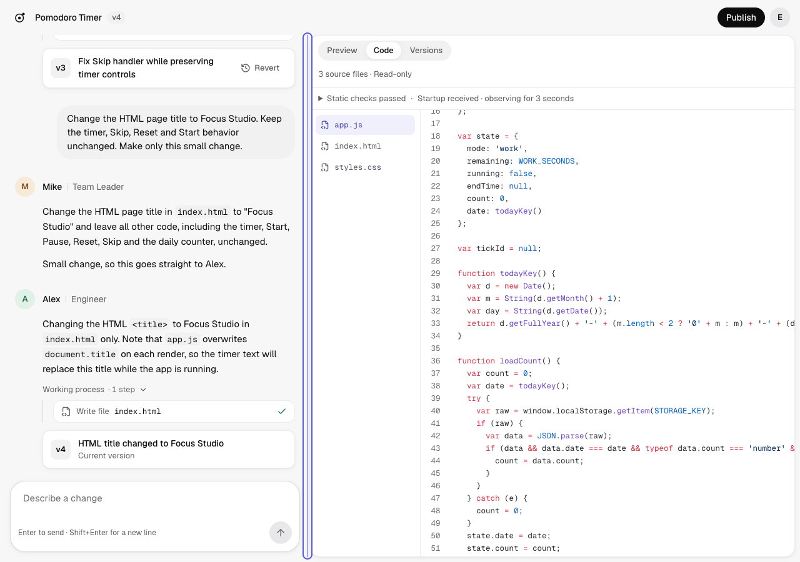
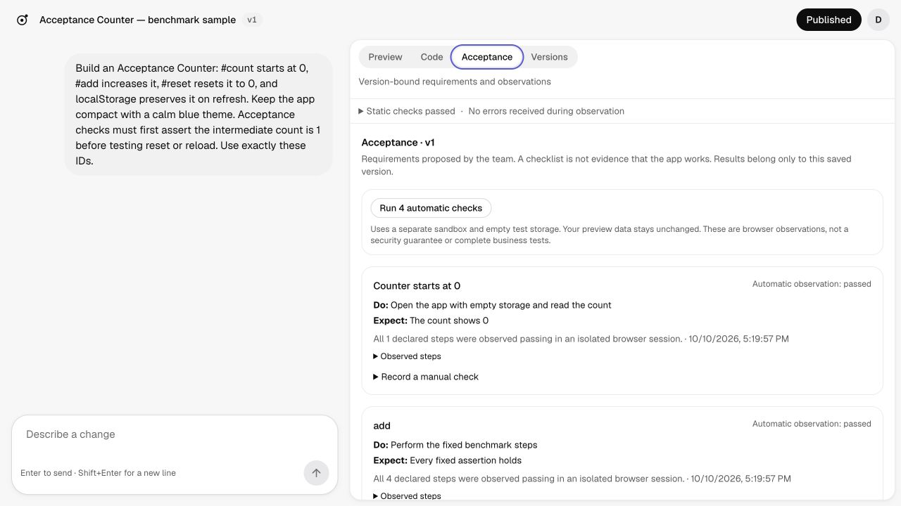

# Atoms Lite 交付说明

2026-10-10 更新。验收标准见 [PRD](docs/PRD.md)。

[在线体验](https://53bg3mbj.insforge.site) · [源码仓库](https://github.com/nomorekuiqian/atoms-demo) · 登录页点 Try the demo account 即可进入（共享账号，项目大家共用）

## 产品现在能做什么

一句话描述需求，Mike 分派，Emma 写验收要求，Bob 规划文件，Alex 写代码并自查，过程实时可见。产出是最多 6 个文件的 HTML/CSS/JS 应用，在沙箱 iframe 里预览，可以继续改、回退、发布。

| 模块 | 内容 | 状态 |
|---|---|---|
| 生成与迭代 | 四角色生成，工具调用过程可回看；继续对话修改，可引用文件或点选预览元素 | 已上线，线上用真实模型测过文件逐段显示 |
| 代码、预览、版本 | 代码高亮、沙箱预览、5 套主题；完整快照、恢复、Diff、源码 ZIP | 已上线 |
| 修复与验收 | 运行报错一键修复；版本绑定验收清单，有限的浏览器自动检查，退化提示 | 已上线。自动检查需手动触发 |
| 发布与分享 | 公开链接指向固定快照；Discover 浏览，Remix 复制 | 已上线 |
| 账号与保护 | 邮箱 / Google / 体验账号；RLS、并发限制、幂等重放、版本冲突检测 | 已上线。Google 未用真实账号走完授权 |

本地 129 项测试、类型检查、lint、构建都通过；真实模型跑过新建、修改、修错三条冒烟，发布流程和 375px 手机视图也测过。线上部署后又用体验账号真实生成并修改了一个应用，文件内容在写入完成前就逐段显示，首个反馈约 1 秒。还没做的是 PRD 全量回归和真机测试。

## 技术选型

前端用 Next.js 15 + TypeScript + Tailwind 3.4 + Zustand。页面、鉴权和 API 在一个项目里，部署只有一个单元。预览用 `iframe srcdoc`：生成物是静态文件，不需要 Sandpack 那套打包；`sandbox` 不开 `allow-same-origin`，生成代码读不到主站 cookie。流式用 SSE，因为只需要服务端单向推送。

后端用 InsForge，数据库、登录、部署都在一个平台上，数据隔离直接写成 RLS 策略。模型通过 OpenRouter 调用，换 key 或换模型只改环境变量。Agent 用 Vercel AI SDK 的 `ToolLoopAgent`，每个角色一个独立循环，我只定义工具、停止条件和预算。四个角色都用 Claude Haiku 5.5，因为一次生成要调好几轮，速度和价格最重要。存版本、记用量、冲突检查放在同一个 Postgres 事务里。本地和线上都直接调用真实模型，不用 mock。

## 关键取舍

**只做纯前端小应用，不装依赖、不带后端。** 一旦允许 npm 依赖，就得有远程构建环境，还要处理依赖安全、构建失败和缓存；一旦生成后端，就得给每个应用开数据库、管权限。这些都会把 Demo 的重心从"多 Agent 能不能把应用做对"拉到基础设施上。限定成静态文件以后，预览就是一个 iframe，发布就是存一份快照，出问题的地方很少。代价也很直接：需要真实数据库或第三方库的应用现在做不了。

**安全边界放在平台，而不是指望模型守规矩。** 模型的输出不可信，提示词写得再严也可能被绕过，比如用户在需求里夹带指令，或者生成的代码本身有问题。所以模型手里只有读写候选文件和做检查的工具，碰不到终端、数据库管理和发布；生成的代码只在不带 `allow-same-origin` 的沙箱里运行。这样即使模型出错，最坏结果也只是生成了一个坏应用，不会波及平台和其他用户。

**完成要靠工具证明，不信模型自己说做完了。** 模型很容易在没检查的情况下宣布完成，或者检查之后又改了文件。所以 Alex 每写一次文件，之前的检查结果就作废，最新版本没通过检查就提交不了；Emma 和 Bob 的产物也要先过校验工具。这样多花几轮调用，换来的是"提交了的版本至少通过了静态检查"这句话一定成立。

**"生成成功"和"功能对"分开记录。** 静态检查只能看出文件齐不齐、引用对不对，看不出按钮点了有没有反应。如果把两者混成一个"通过"，用户会以为应用已经验过了。所以浏览器验收单独跑，结果绑定到具体版本和源码摘要上，新版本不会继承旧版本的通过记录。界面上显示的是"静态检查通过"，不是"测试全部通过"。

**用多 Agent，但给它套上预算。** 拆成四个角色，是为了让需求、计划和代码各自能被单独检查和修正，每个角色的上下文也更干净。代价是更贵、更慢：新建一个小应用约 30 秒、6.6 万 token，比单次生成多出好几轮调用。ReAct 循环还可能卡住，验证时就遇到过 Alex 反复读同一个文件直到 token 用完。所以每次任务都有硬上限（56 次模型调用、160 次工具调用、240 秒、50 万 token），超了就停，不产生新版本。至于多 Agent 到底值不值这个成本，目前还没有结论，这就是下面 P1 要回答的问题。

**版本存完整快照，不存差异。** 每个版本都存全部文件，读取和恢复都是直接取一份，不用回放一串 diff，历史也不会因为某次合并出错而损坏。重复存储在 6 个文件的规模下几乎没有成本。发布指针单独存，之后怎么改，已发布的应用都不受影响。

## 接下来怎么排

排序的原则是：先证明多 Agent 这套架构值得，再补 Alex 最缺的能力，最后才扩大能生成的应用范围。越往后的事情越依赖前面的结论，反过来做，问题只会越堆越难查。

| 优先级 | 做什么 | 为什么排在这里 | 做到什么算完 |
|---|---|---|---|
| P1 | 新架构十任务对照：Alex 单独做 vs 团队做 | 多 Agent 是这个产品最核心也最贵的设计，却还没有数据支持。旧流水线的结果是单独 10/10、团队 9/10，团队并没有更好。如果新架构也是这样，就该退回更简单的方案，后面的工作也要跟着调整 | 同一批任务、独立断言，比较成功率、耗时、token 和失败类型 |
| P2 | 把浏览器检查做成 Alex 能调用的工具 | "按钮点了没反应"这类问题静态检查发现不了，只能靠浏览器跑一遍。现在要用户自己点验收、再点修复，Alex 自己看不到运行结果，修完也不知道修好了没有 | 限制动作种类、时长和重试次数；行为通过率提升，原有功能不被改坏，并报出多花的时间和钱 |
| P3 | 后台任务、检查点、断线恢复 | 现在任务绑在一次请求上，断线就白跑。但目前一次生成只要半分钟左右，断线还不是主要问题；等它真成了主要失败原因再引入队列，免得过早背上运维负担 | 断线后能从某一步接着跑，能取消，能查状态 |
| P4 | 支持 npm 依赖、给生成应用配后端 | 这是用户价值最大的方向，但会把第一条取舍里避开的问题全部带回来：构建环境、依赖安全、数据隔离。只有前面的评测和验收足够可靠，才能判断放开之后质量有没有掉 | 沙箱里能装依赖、能打包；生成应用的数据按项目隔离，受 RLS 保护 |

P1 出结论之前，我不会加新角色，也不会给不同角色分配不同模型。之后每加一项能力，都同时报出质量提升和多花的时间、费用。

相关文档：[ReAct 架构与验证](docs/REACT-AGENTS.md) · [固定任务实验](benchmarks/README.md) · [本地运行与配置](docs/DEVELOPMENT.md)
