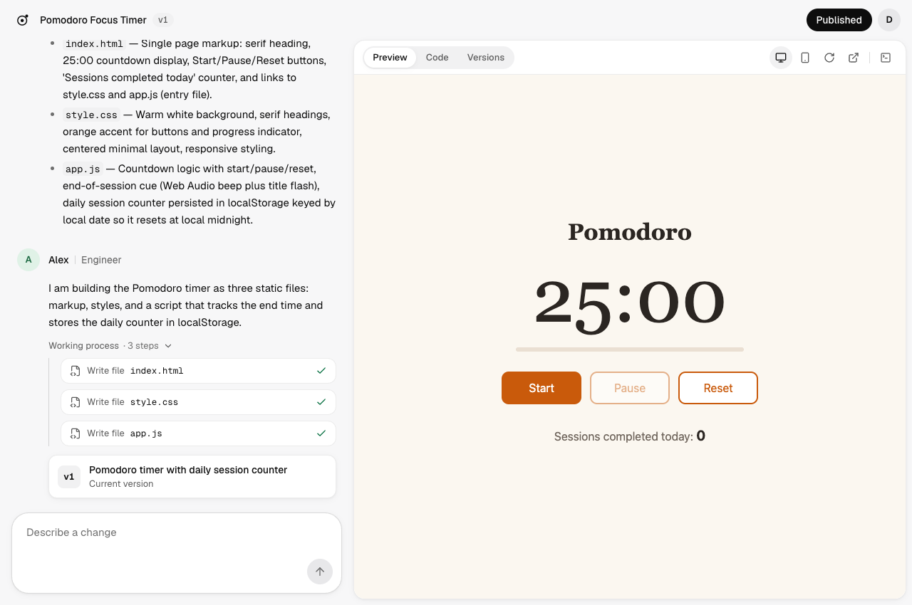
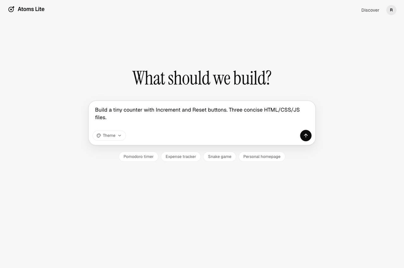
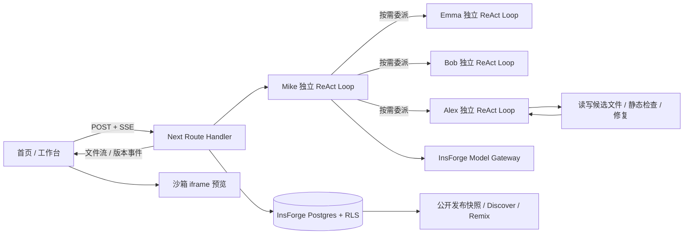
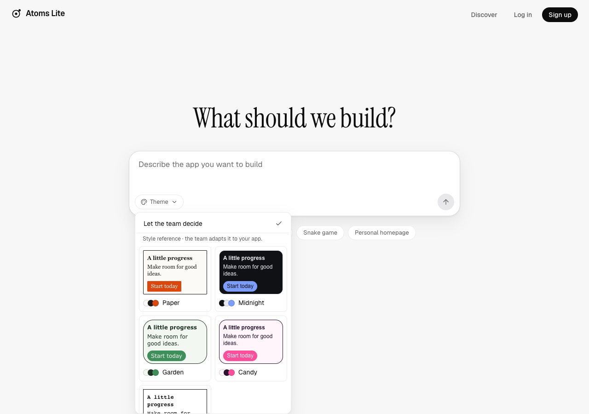

# Atoms Lite 开发与运行

产品说明、技术取舍与后续计划见仓库首页 [README](../README.md)。本文是本地运行、配置和历史验收记录。

用一句话生成可运行的 HTML/CSS/JS 应用。Mike 分派需求，Emma 整理产品要求，Bob 规划文件，Alex 编写代码；过程流式展示，支持继续修改、历史版本、运行错误修复和公开发布。增强版还支持版本检查、文件引用、点选元素修改、版本 Diff 与源码 ZIP。现在也支持版本绑定的验收清单、独立沙箱行为检查、父版本退化提示和带证据修复。

**[在线体验](https://53bg3mbj.insforge.site) · [GitHub](https://github.com/nomorekuiqian/atoms-demo) · [增强版验收](RELEASE-ENHANCED-2026-10-10.md) · [v1.0 基线](RELEASE-2026-10-10.md)**

登录页点击 **Try the demo account**，无需输入密码。共享体验账号中的修改对所有体验者可见；需要独立项目可自行注册。



## 示例应用

以下三个应用均由真实模型生成，并在无登录浏览器中验收。数据保存在访问者自己的浏览器。

- [番茄钟](https://53bg3mbj.insforge.site/p/my-pomodoro)：开始、暂停、重置和今日完成次数。
- [记账本](https://53bg3mbj.insforge.site/p/expense-tracker)：分类、月度合计、新增/删除、刷新保留。
- [贪吃蛇](https://53bg3mbj.insforge.site/p/snake-classic)：键盘或手机方向按钮、暂停、高分记录。



## 技术与运行模式

Next.js 15 App Router / TypeScript / Tailwind CSS **3.4** / Radix + shadcn 风格组件 / Zustand / Vitest。InsForge 提供 Postgres、Auth、RLS、Model Gateway 与 Sites 托管。

本地和生产都通过 OpenRouter 调用**真实 Claude Haiku 5.5**（四个角色均使用 `anthropic/claude-haiku-5.5`），没有 mock 模式，也没有每日生成次数上限；每个账号最多同时运行两个生成任务。单元测试仍用脚本化模型驱动同一套 SDK 工具循环，它们不代表真实模型的效果。



编排器 `lib/agents/` 不依赖 Next.js。使用 **Vercel AI SDK 7 `ToolLoopAgent`**，四个角色各有独立上下文、工具权限、完成条件与循环步数上限。Mike 通过工具按需委派；新应用要求 Emma 契约与 Bob 计划，已有应用可直接交给 Alex。每个角色必须通过工具完成校验，不能仅用最终文字宣称完成。

Alex 在候选快照中读写文件、运行静态检查、观察失败并继续修复。文件内容在模型生成工具参数时就通过 SSE 逐段推送到草稿；执行时校验失败的草稿会被撤回，没有提交的候选不会覆盖旧版本。工具轨迹随消息保存，可在 Working process 中查看。全局上限为 48 次模型步骤、160 次工具调用、8 次委派和 240 秒；每步结算后检查累计 300,000 token 阈值（可能超出一个在途调用）。旧版的单次文本生成器只供历史基线脚本使用。

**浏览器行为验收仍是独立入口，尚未接进服务端 ReAct loop；没有后台任务检查点或断线续跑。** [架构与本轮验证](REACT-AGENTS.md)。

## 需求验收与行为检查

打开工作台 **Acceptance**：自动检查执行固定的点击、输入、文本/数量/属性断言及刷新；人工检查需记录实际观察。结果绑定源码摘要和不可变版本，新版本不能继承旧版“通过”。父版本同项曾通过、当前失败时显示退化；点击 **Repair this failure** 只触发一次修复，修复后需要重新运行检查。

测试在单独沙箱和空测试存储中进行，普通预览数据不变。自动回传来自生成环境，只是有限范围的行为观察；“静态检查通过”“没有观察到报错”“人工确认”和“自动观察通过”不是同一件事。旧版本没有验收契约时会明确显示未记录。

[交付证据](ACCEPTANCE-DELIVERY-2026-10-10.md) · [真实模型对照实验与原始结果](../benchmarks/README.md) · [公开验收样本](https://53bg3mbj.insforge.site/p/acceptance-benchmark-counter)。样本由真实团队实验生成后导入，版本保留来源标注。**该实验针对迁移前固定流水线**，十个小任务中直接 Alex 为 10/10，团队为 9/10；不宣称多代理天然改善生成质量。

## 本地运行

需要 Node 22、npm、自己有权访问的 InsForge 项目，以及一个 OpenRouter API key。本地每次生成都会真实调用模型并产生费用。

```bash
git clone https://github.com/nomorekuiqian/atoms-demo.git
cd atoms-demo
npm ci
cp .env.example .env.local
# 填入自己项目的 URL、anon/admin key、OpenRouter key 和体验账号
npm run dev
```

新后端需登录并连接 InsForge 后执行：

```bash
npx -y @insforge/cli db migrations up --all
npx -y @insforge/cli config apply
```

体验账号需先在对应后端注册，再将邮箱/密码填入服务端变量。切勿将本项目生产凭据复制到公开文档。

| 变量 | 用途 |
|---|---|
| `NEXT_PUBLIC_INSFORGE_URL` / `NEXT_PUBLIC_INSFORGE_ANON_KEY` | 公开 SDK 配置；数据受 RLS 保护 |
| `INSFORGE_API_KEY` | 服务端管理凭据，用于所有者校验后的原子提交、发布 / Discover / Remix |
| `OPENROUTER_BASE_URL` / `OPENROUTER_API_KEY` | OpenRouter 地址与 key；服务端专用 |
| `OPENROUTER_CHAT_MODEL` | Alex；默认 Haiku 5.5 |
| `OPENROUTER_FAST_MODEL` | Mike / Emma / Bob；默认 Haiku 5.5 |
| `DEMO_EMAIL` / `DEMO_PASSWORD` | 一键体验登录，密码不送到浏览器 |
| 旧 `record` 请求 | 新循环返回明确 400；改用 `scripts/smoke-react.mjs` 记录工具轨迹 |
| `NEXT_DIST_DIR` | 可选，本地多个服务使用独立构建目录 |

```bash
npm run typecheck
npm run lint
npm run test
npm run build               # 每次部署前必须通过
npm run deploy
```

真实接口冒烟会消耗额度；仅在需要时执行：

```bash
node --env-file=.env.local scripts/smoke-generate.mjs "Build a small timer" --app http://localhost:3000
node --env-file=.env.local scripts/check-rls.mjs http://localhost:3000
node --env-file=.env.local scripts/check-publish.mjs http://localhost:3000
```

后两项创建并清理临时项目，RLS 检查还会注册测试账号。生成脚本会真实调用模型。

## 功能与验收

| 范围 | 状态 |
|---|---|
| F1–F9：账号、项目、四角色流式生成、代码、预览、迭代、保存、发布 | 已实现、线上验收 |
| E1：查看历史 / Restore / Revert | 已实现，Restore 另存新版本 |
| E2：Issue Report / Resolve | 真实报错→Resolve→原按钮再次点击无报错 |
| E3：Discover / Remix | 已实现，复制发布代码，不复制对话 |
| E6：5 个主题预设 | 已实现，Paper/Midnight 真实对照验证 |
| M6：明暗、375px、加载/错误、断网重试 | 已检查，主站浏览器无未处理异常 |
| M7：真实模型、3 个示例、文档、交付回归 | T1–T13 通过；完整证据见发布记录 |
| M8：原子保存、幂等重试、并发版本冲突 | 隔离数据库故障注入及线上真实重放通过 |
| M9：版本静态检查与预览观察 | 绑定版本/摘要/会话，发布重新核对快照 |
| M10：文件引用与 Diff | 引用版本校验；按需比较前一版，不改历史 |
| M11：源码 ZIP | 当前/历史版原始源码，所有者鉴权，运行说明 |
| M12：点选元素 | 可移除上下文，排除输入值，真实模型修改验证 |
| M13：原创头像、主题卡、空态、真实封面 | 深浅/375px/慢网/404 与线上资源通过 |
| M14：增强交付 | T1–T21，真实完整链路；v1.1 附注标签记录 SHA/部署 |

T1 首页、T2 注册、T3 连续三次真实生成、T4 Code、T5 迭代、T6 恢复、T7 修复、T8 发布复制、T9 匿名应用、T10 体验账号、T11 持久化、T12 用户隔离、T13 手机布局的逐项证据与边界在 [发布记录](RELEASE-2026-10-10.md)。T3 三次为 22.4 / 25.5 / 23.2 秒。本轮单测 **98 项**通过；增强版重新完成 T1–T13 真实链路，新建计数器到功能检查约 16.2 秒，详见[增强验收](RELEASE-ENHANCED-2026-10-10.md)。



增强测试脚本接受 `APP_URL` 和 `PLAYWRIGHT_MODULE`（已安装的 Playwright 路径）。`check-version-diff.mjs`、`check-export.mjs`、`check-element-selection.mjs`、`check-visual-assets.mjs` 使用忽略目录内的私有 QA 会话；不要提交凭据。`check-release-flow.mjs` 新建隔离账号并调用真实模型四次，成功后清理项目、保留用量；目标必须已明确配置为真实模型。它不适合作为免费 CI 的每次运行测试。

## 关键取舍

- **iframe srcdoc 而不是 Sandpack。** 仅面向小型静态应用，无需安装依赖和远程构建。生成代码始终在 `sandbox="allow-scripts allow-forms allow-modals"` 中运行，禁止 `allow-same-origin`。
- **可信外壳 + 沙箱 iframe。** 公开页与主站同域，但生成代码在 opaque origin 的 iframe 内，不能读取主站 DOM/cookie。`localStorage` 由父页按项目/公开链接隔离桥接；不是跨设备云同步。
- **完整快照而不是 diff 存储。** 读取/恢复简单，历史不改写；代价是存储重复。发布指针独立，后续修改不会自动改动已发布应用。
- **结构化工具写入候选文件。** 草稿随工具参数流式增长，但只有通过 SDK 参数校验与路径检查、实际执行的写入才进入候选快照；部分输出不会标为成功版本。XML 文件标签解析属于迁移前实现。
- **Route Handler 而不是 Edge Function。** M0 线上连续 150 秒 SSE 实测逐条到达；编排器保持框架无关，便于以后迁移。该次测试是历史证据，不是无限时长承诺。
- **全部走真实模型。** 早期用 mock 开发省额度，现在本地和生产都直接调用真实模型；真实验收中发现的截断输出和删除报错按钮问题，分别收紧了完整性判定与修复提示。
- **Haiku 优先。** 生产与本地配置一致，保留模型切换环境变量。生成不限次数，费用受 OpenRouter key 自身的消费上限约束。

## 维护与已知边界

已启用 InsForge 每日访问 Discover（台北 09:00），首次计划 2026-10-11。尚需观察首条执行记录；是否计入服务商活跃度由平台决定。不要把 schedule 创建成功等同于项目永不暂停。

生成应用仅支持 HTML/CSS/JS，最多 6 文件；不支持 npm 构建或自定义后端。生成没有每日次数上限，共享体验账号的用量会直接计入 OpenRouter 费用。

M8–M14 已完成。检查结果是静态检查与当前预览会话的观察，不能代替全部业务测试；动态导入和外部依赖仍有边界。元素位置是修改线索。源码 ZIP 不带托管存储数据；解压后用 HTTP 服务运行，外链仍需网络。

后续优先级：先完善运行检查与外部资源兼容，再考虑动态作品分享卡及应用后端能力。可选小物件和背景纹理已取消，不增加无用途装饰。Google 登录已加入，真实账号完整授权尚需账号本人验收，见 [Google 登录](GOOGLE-LOGIN.md)。

干净克隆的安装与完整生成已验证（当时使用 mock 模式）。依赖审计仍有 9 项告警（6 high / 3 moderate，0 critical）；升级建议涉及 Next 16 / Tailwind 4，与本题固定栈冲突，未强制升级。详见验收记录。
