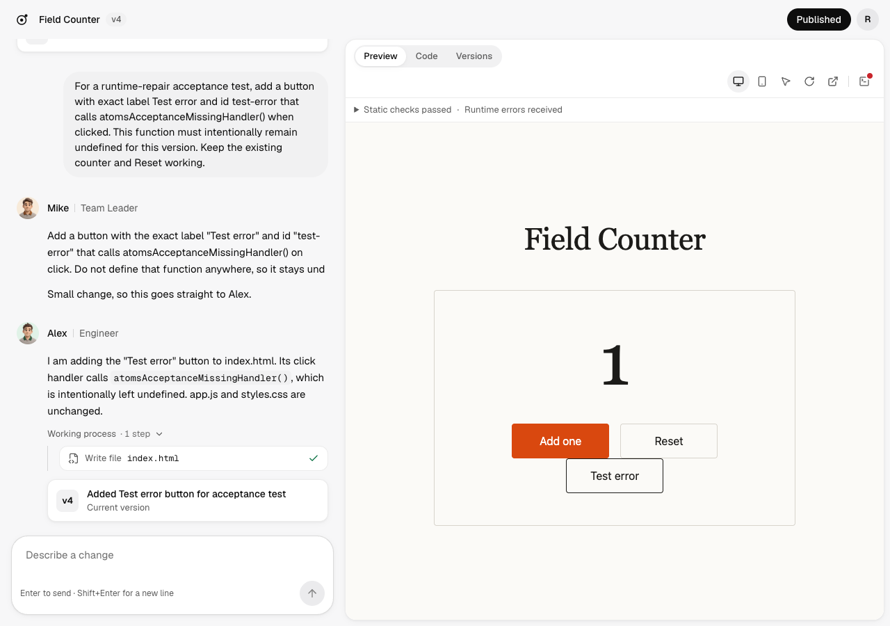
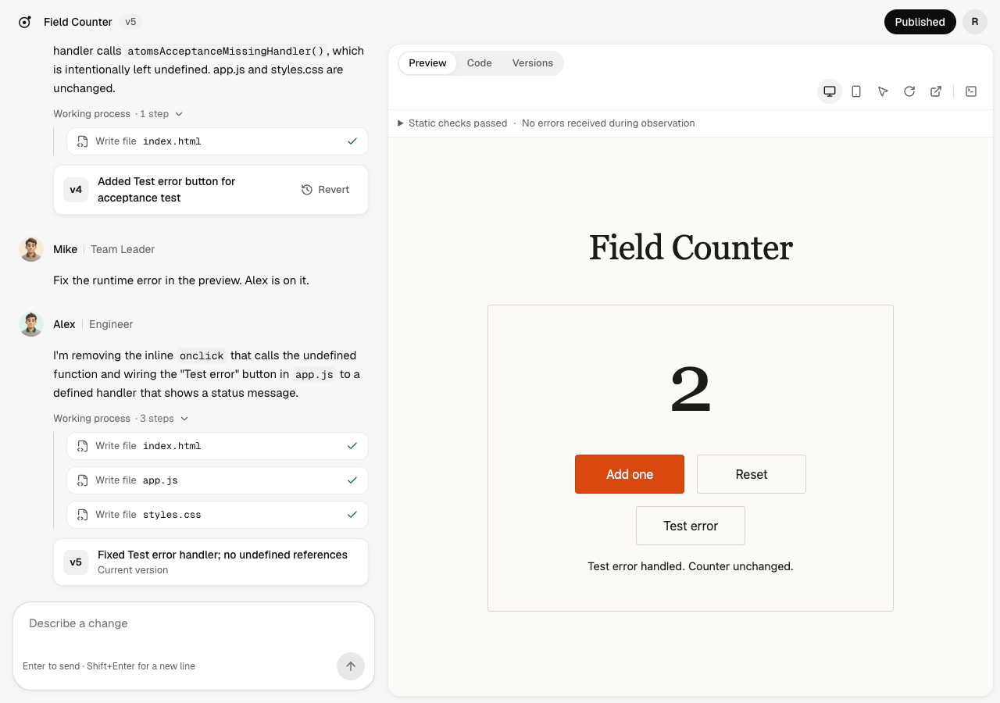
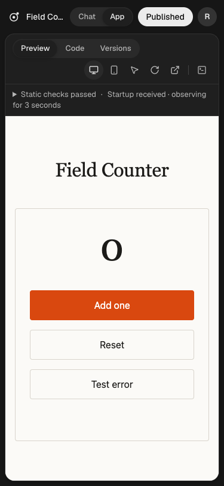

# Atoms Lite 增强版交付 — 2026-10-10

在线：https://53bg3mbj.insforge.site · 公开仓库：https://github.com/nomorekuiqian/atoms-demo

M0–M7 的 `v1.0` 基线保持不动。本轮完成 **M8–M14**，发布引用为 **`v1.1`**。最终精确 Git SHA、部署 ID 和发布后检查写入该附注标签：`git show v1.1`；不在提交内部填自身尚未存在的 SHA。下面列出实际功能验收所对应的版本。

## 版本与环境

| 里程碑 | 提交 | 部署 ID |
|---|---|---|
| M8 原子保存/幂等 | 5e63a32 | 450fcf2e-1571-4501-882d-4574db8502c3 |
| M9 版本检查 | f29bed3 | 94111c6d-00c0-42f8-b1c0-d7b63f662159 |
| 工作台审计修复 | c3c861f | d062e8c6-df1d-486a-8c1a-ef5edc9e58b1 |
| M10 文件引用 | cf321dd | 2e32992f-4910-4f2b-99be-09a4bdfdf56f |
| M10 版本 Diff | f3bf777 | 2e32fe67-d47c-49a5-90f4-ce0cc0d03d1c |
| M11 ZIP 导出 | 6bd06d7 | f80e9a11-5b47-4f5c-9abc-64e4ca178be0 |
| M12 元素选择 | 0c62abe | 85f7462d-e355-4aee-8632-631bcfbab6be |
| M13 头像与 V2–V4 | 727acec | 5284ea9a-17c4-4efb-9000-82dacbbccb82 |
| M14 收尾、依赖修复、发布记录 | v1.1 | 附注标签记录最终部署 |

生产 `LLM_MOCK=0`，四角色使用 `anthropic/claude-haiku-5.5`；本地 `LLM_MOCK=1`。检查并不证明模型一定完成所有需求。真实 Google 登录代码由独立提交 `4a65700` 加入，已保留并纳入全量检查，完整账号授权边界见 [GOOGLE-LOGIN.md](GOOGLE-LOGIN.md)。

## T1–T13 全链路复验

在 M13 线上版本运行 `scripts/check-release-flow.mjs`，新建隔离 QA 账号，不消耗共享体验账号的生成额度。

| 用例 | 实际结果 |
|---|---|
| T1 | 未登录首页和四个示例需求入口可见 |
| T2 | 浏览器新邮箱注册，进入空 Dashboard |
| T3 | 真实四角色生成 Field Counter，三个完整文件，开始请求至按钮功能检查完成约 16.2 秒；加一/重置有效。本次一次新生成，M7 连续三次的历史证据仍单列 |
| T4 | Code 可读，切换 app.js 并加入聊天 |
| T5 | 文件引用+选中按钮发送真实迭代：Add one 改为 Add another，背景变 #0f1115，按钮高度 ≥48px，计数有效 |
| T6 | Restore v1 另存 v3；逐文件等于 v1，旧版本保留，发布指针仍为 v2 |
| T7 | 真实模型增加故意调用未定义函数的 Test error 按钮；点击出现 Issue Report；Resolve 生成修复版，保留原按钮，再点击无报错，计数器继续有效 |
| T8 | 发布弹窗成功，Copy 后剪贴板精确等于公开 URL |
| T9 | 无 cookie 浏览器使用公开应用；iframe origin 为 null，读取 parent.document 被拒绝 |
| T10 | 一键体验登录成功，Dashboard 可见三个示例 |
| T11 | 退出后使用全新浏览器密码登录，刷新恢复同一源码、版本和选中元素的历史消息 |
| T12 | 体验账号访问 QA 私有项目出现 Not found，无 iframe；额外 RLS 脚本 9/9 通过 |
| T13 | 375px 公开应用与深色工作台无页面横向溢出，Chat/App 可切换 |

真实链路四次生成请求，使用记录合计 **15,381 input / 8,755 output tokens**。项目删除后四条 usage_logs 保留，project_id 置空；这些 token 数不是费用账单或剩余额度。未获取网关可用余额，不承诺还可生成多少次。

## T14–T21 增量证据

| 用例 | 验证范围与证据 |
|---|---|
| T14 | 隔离数据库分支注入晚期写入失败：版本/指针/消息/用量回滚；重复请求只写一次；同底稿并发只有一个成功。线上真实生成重放无额外 Agent，过期版本 409；SSE/重试/恢复另有单测与浏览器证据。见 M8 记录 |
| T15 | 最终线上重新执行完整、缺资源、语法错误、延迟运行错误和启动消息丢失五样例。超时用例通过丢弃 ready 消息验证计时器，不声称覆盖 CPU 死循环 |
| T16 | M10 线上加入/移除/断网重试/历史/过期/非法路径/越权通过；本次真实链路再次把 app.js 与元素共同传给 Alex |
| T17 | 首版/无变化/增删改/空文件/长 CRLF/375px/指针不变通过；本次实际生成 v1→v2 的文本差异可展开 |
| T18 | 当前及历史 ZIP 解压逐字节相符、冲突 README 不覆盖、危险路径/越权拒绝、固定样例本地 HTTP 计数有效；本次真实 v2 ZIP 再次逐文件比对 |
| T19 | 桌面/375px，点选不触发按钮，Esc 恢复；不采集表单、editable、隐藏内容；错误来源/旧 session 拒绝；真实模型改选中按钮且功能继续有效 |
| T20 | 四头像 24/32px、深浅/375/1280、慢网/404 回退；8 份资源线上 200、类型/大小正确；固定布局；清单见 assets-manifest.json |
| T21 | 真实生成→文件与元素迭代→检查→Diff→ZIP→发布完整通过；T1–T13 无功能退化。最终发布后检查记录在附注标签 |

最终工作台回归再次通过 375/768/900/1280 外框稳定、文件与标签滚动、分栏拖动/键盘/重置、历史故障重试且不抢标签、历史新标签、输入增高、Console 大小与阅读位置。公开三示例分别复验计时开始/暂停、记账新增/刷新/删除、贪吃蛇触控开始/暂停/恢复。

## 质量、范围和边界

- 98 项单测、lint、typecheck、生产构建通过。Impeccable 本批扫描无 findings；真实尺寸视觉检查另行完成，不用扫描代替视觉验收。
- 按 code-review 技能本地检查 M8–M14 diff 及所有者/RPC/版本/消息/沙箱边界。修复 defer 外部脚本内联后提前执行、Diff chunk 加载失败及跨项目目标、公开读取错误误作空/不存在。没有外发审查评论。
- 发布测试曾因随机 slug `check-mv2...` 中的 v2 误报“未发布版本泄露”，改为检查专用源码标记后 13/13 通过；不是生产发布指针故障。
- sharp 显式开发依赖升级至 **0.35.5**，移除所选旧版本新增的告警；已制作衍生图保持原字节。生产依赖审计回到既有 **9 项（6 high / 3 moderate / 0 critical）**，涉及 Next/Tailwind/PostCSS 依赖链；未强制改变题目约定的主版本。不能称为安全审计全绿。
- 私有凭据实际值在 Git 跟踪文件及客户端构建产物中匹配 0；不把服务端变量名称误当作泄露。
- 版本检查有明确范围：静态资源/路径和当前会话运行观察；外部依赖、动态导入与全部业务行为未自动验证。Diff 超预算显示完整前后块并注明。元素 selector 只是修改线索。
- ZIP 是确切原始快照，加独立运行说明；外部服务/字体仍需网络，平台注入、会话/聊天/托管存储数据不导出。用户自行写入源码的内容不被擅自删除。
- V1–V4 已交付；V5 小物件、V7 新纹理取消；V6 动态分享图因独立存储/权限/刷新设计而延期，不属于 M13 强制头像范围。
- 原生手机中文 IME、Google 账号完整授权、社交平台分享预览未实机/真人验收，不用桌面模拟代替。
- 体验账号 2026-10-10 UTC 的 10 次生成额度已用满，UTC 次日重置；独立注册账号另有配额。每天 UTC 01:00 的 InsForge 访问计划已启用，首次计划 10 月 11 日，尚不能证明防暂停效果。

临时 QA 项目在最终验证后备份到本机忽略目录并清理；保留测试账号和用量审计记录，不删除其他工作产生的数据。HR 投递与笔试文档填写仍由用户执行，本轮未发送外部消息。
