# Atoms Lite — UI 基础体验审计

> 2026-10-10，当前线上页面实测 + 当前工作区代码定位。结论：先修布局、阅读状态和版本操作，再做视觉素材。此次仅写文档，没有修 UI、发送生成请求、Restore、发布或删除项目。

## 1. 范围与证据边界

- 线上站点：`https://53bg3mbj.insforge.site`，使用已有登录态，独立审计标签页。
- 工作台样例：Pomodoro Timer，项目 `95df4b5e-7426-4390-912d-e66635f69c47`，当前 v5。
- 检查：首页→项目列表→Preview/Code/Versions→Console→历史加载→发布弹窗→长文本输入。宽度 1470、900、768、375px；375px 为浏览器 viewport，未冒充真机测试。
- 源码参考：审计期间 HEAD `ad1275a`，工作区有并行未提交修改，生产 SHA 未核验，不能视作源码与线上完全一致。本文行号是本次定位提示，后续可能变化。
- 截图均为本次捕获并查看，保存在 [ui-audit-2026-10-10](ui-audit-2026-10-10/)。未用旧 screenshots 目录作为证据。
- 未做：新生成/运行中/断网/真实软键盘/深色/读屏器全流程/浏览器 200% 缩放。因此不宣称完整可访问性合规，也不把推测列为已实测缺陷。

## 2. 用户指出的两项问题

**左右 panel 无法拖拽：确认。** 当前外层是固定 `minmax(360px,38%) 1fr` 的 grid，没有 separator、pointer/keyboard resize 或持久化宽度。见 U1。

**切换 Code / Versions / Preview 导致 panel 尺寸变化：本次常规状态未复现外框变化，保留待复现。** DOM 测量与截图如下（CSS px，四舍五入）：

| viewport | 标签 | 右侧外框 x / y | 宽 × 高 |
|---|---|---|---|
| 1470×677 | Code、Versions；Preview 截图对照同位置 | 568.52 / 56 | 893.48×613 |
| 900×700 | Preview、Code | 376 / 56 | 516×636 |
| 768×700 | Preview | 376 / 56 | 384×636 |
| 375×812 | Code；Preview 截图对照同位置 | 8 / 56 | 359×748 |

不能据此否认用户之前遇到的情况：当时可能是另一部署或其他状态。已确认的相关问题是：工具栏随标签增减、Code 固定文件栏挤压内容，以及 Console 开启时预览可用高度减少 192px。必须补“固定外框+独立内容滚动”的自动回归，覆盖长代码、空态、历史提示、Console、流式生成和滚动条出现，不以本轮未复现直接关闭用户反馈。

## 3. 优先修复项

优先级：P1 = 阻碍主要操作或明显影响连续工作；P2 = 基础打磨，应在视觉增强前后集中补齐。这里没有把每个缺口都算作故障。

### U1 · P1 · 分栏不可调整，工作台无法适配当前任务【代码确认 + 页面观察】

- 位置：`components/workspace/workspace.tsx:516`，截图 03/06/08。
- 影响：代码阅读、预览检查、长对话需要不同空间；固定 38% 和 360px 最小聊天宽度在中屏特别局促。
- 修复：可拖拽 separator，明确左右最小宽度；窄于可用阈值切单面板。支持键盘方向键调整、双击/按钮复位、合理保存偏好；拖拽越过 iframe 时仍能接收事件，结束/取消时恢复选择与点击。
- 验收：拖到两端不挤没操作；tab 切换宽度保持；刷新保留；键盘可用；不同 viewport 不产生页面横向溢出。新增拖拽不得改变 iframe sandbox。

### U2 · P1 · 768px 工具栏右侧被裁切【实测】

- 证据：截图 08，Console 已在面板外不可见。375px 因隐藏设备切换反而能显示；说明存在中间断点缺口。
- 位置：`workspace.tsx:377–408`，同一行放三标签和五操作，只有设备按钮依赖 `sm`，外框 overflow-hidden。
- 修复：按面板实际宽度安排工具，不仅看全窗口；将低频工具放“更多”，或拆成固定工具行。不能仅缩小图标/点击区域。
- 验收：375/768/820/900/1280px 及拖拽极值下全部功能可见或可从菜单进入，键盘焦点不会进入被裁掉的按钮。

### U3 · P1 · 手机 Code 区被固定文件栏挤占【实测】

- 证据：截图 10，359px 面板内 176px 文件栏，加行号后代码正文只剩很窄的空间；900px 时固定 192px 也显著挤压内容（截图 07）。
- 位置：`code-view.tsx:59`：`w-44 shrink-0 ... sm:w-48`。
- 修复：小面板用顶部文件下拉/可收起 drawer；桌面允许收起或调宽，长路径可完整查看。代码保留横向滚动，可选自动折行。
- 验收：375px 默认代码优先占满可用宽度，三文件均能切换，长行不推宽外框，文件名与内容对应。

### U4 · P2 · 切换标签丢失代码阅读位置【实测】

- 操作：滚到约第 59 行（截图 14），切 Versions，再切 Code，回到第 1 行（截图 15）。
- 位置：`workspace.tsx:439` 条件挂载 CodeView；无文件/版本维度的阅读位置保存。
- 修复：保存每个 project/version/path 的纵横滚动位置，或保持面板挂载；恢复在高亮完成后进行，避免布局变化再次移位。
- 验收：代码→版本→代码、文件 A→B→A 后位置保留；首次打开新版本有明确策略，不错误套用另一份文件位置。Preview 本次代码已保持挂载，避免为修 Code 破坏已有预览状态。

### U5 · P1 · 历史版本加载无即时反馈，失败只给短暂 toast【实测 + 代码确认】

- 操作：点击 v1，列表保持原样无 loading；后续浏览器可访问性快照出现 `Couldn't load that version.`。又尝试 v4，未观察到成功进入历史预览。截图 12/17记录列表停留，不伪称截图捕到了已消失的 toast。
- 位置：`workspace.tsx:121` 的 view 直接异步读取，无 loading 状态、请求序号或内联重试。
- 根因边界：本轮没有查请求错误，无法断言是 RLS、网络还是数据；线上历史查看本次未通过应明确记录。
- 修复：行级加载、持续可见的错误和重试；切换版本时采用最后一次选择，防止较慢的旧响应覆盖新选择；离开 Versions 后迟到响应不能突然抢走当前 tab。
- 验收：成功、失败、慢请求、快速连点两个版本各测；目标版本明确，失败不改变当前版本、不默默回退。

### U6 · P1 · 历史预览“新标签打开”会打开当前版【代码路径确认，端到端受 U5 阻挡】

- 位置：`workspace.tsx:398` 始终 `/preview/{projectId}`；`app/preview/[id]/page.tsx:12–16` 始终取 `current_version_id`。
- 影响：历史预览中的放大操作不保持所看版本，用户可能误把当前版当成历史结果。
- 修复：携带明确 versionId，并校验项目/用户归属；或历史状态禁用此操作且解释。新标签标题/页内标识显示版本。
- 验收：工作台历史 v1 与新标签内容一致，且当前/已发布指针完全不变。当前版与历史版分别测试。

### U7 · P2 · 多行需求框不会随输入增长【实测】

- 证据：截图 16，八行草稿只有约两行可见；DOM clientHeight=60、scrollHeight=192。测试草稿已清除，未发送。
- 位置：`composer.tsx:55–57` 固定 rows=2、resize-none，无自动高度；缺少换行提示。
- 修复：自动增长至约 6–8 行或面板高度上限，然后内部滚动；给 Enter 发送 / Shift+Enter 换行提示。保留已有 isComposing 检查。
- 验收：1/4/12 行、粘贴多段、中文输入法、移动软键盘均可用；发送按钮不跑出可视区；草稿切 Chat/App 保留。真实手机输入法仍待测试。

### U8 · P2 · 标签页语义关联缺失【DOM + 代码确认】

- 实测五个 tab 的 aria-controls 指向 ID 均不存在（Chat/App/Preview/Code/Versions）。Radix Trigger 已生成控制关系，但内容用普通 div 而不是对应 TabsContent。
- 位置：`workspace.tsx:378`、`:506` 及内容容器；`components/ui/tabs.tsx` 已导出 TabsContent 但这里未使用。
- 修复：正确建立 tab/tabpanel、aria-labelledby 和 hidden；同时确保预览保留挂载、焦点切换合理。
- 验收：箭头键切换、Tab 进入相应面板，隐藏内容不可聚焦；DOM 关联有效。随后用读屏器实测，不能用截图宣称全面无障碍合规。

### U9 · P2 · Console 固定高度，缺少工作区尺寸控制【实测 + 代码确认】

- 证据：截图 11。空 Console 仍占192px，生成应用可视区域明显缩小；这种内部变化是当前设计行为，不等于已复现外框跳动。
- 位置：`workspace.tsx:316` `h-48 shrink-0`。
- 修复：支持有界调高/收起，记忆偏好；低高度窗口采用抽屉，始终留出可操作预览。滚动旧日志时不要每条新日志都强制拉底，提供“回到最新”。
- 验收：600px 高窗口、历史提示+Console、长错误堆栈、375px 下关闭入口始终可达，父面板外框不变。日志滚动项为代码推导，未在本轮制造实时日志。

### U10 · P2 · 版本摘要截断后缺少查看全文入口【实测】

- 证据：截图 12，多个版本的差异摘要在手机上只显示开头；恢复按钮进一步压缩文字，点击行本应预览但受 U5 影响。
- 位置：`version-list.tsx` 摘要 `truncate`，没有完整详情/展开。
- 修复：允许两行摘要或展开详情，保留时间/Current/Published/Viewing；Restore 明确写出目标版本。与已计划的 N3 Diff 共用详情入口。
- 验收：长摘要、同名前缀、手机触控、键盘均能看清恢复目标；不靠 hover tooltip 作为手机唯一全文入口。

### U11 · P2 · 首页返回已有项目的入口藏在账户菜单【实测，信息架构改进】

- 证据：截图 01 首页只有 Discover 和头像；点击 Account 才有 Projects，截图 02 项目列表本身清楚。
- 修复：已登录首页给“我的项目”直接入口或最近项目区域；首访保留清晰主输入。示例封面 V4 可补充能力认知，不应替代返回已有工作的入口。
- 验收：已登录用户无需理解头像菜单即可恢复工作；手机保持主操作清楚。

### U12 · P2 · 文件切换可能短暂显示前一个文件的高亮内容【代码风险，未做慢网复现】

- 位置：`code-view.tsx:10–25`，code/path 改变后旧 html 未立即清空；新异步高亮返回前仍可渲染旧内容。
- 修复：高亮结果绑定 path+content hash，失配时先显示当前纯文本；避免“文件名已变，内容仍旧”的瞬时错配。
- 验收：延迟高亮、快速 A/B 切换、流式→完成均不串内容，仍保留阅读位置。此条不要记为已实测线上故障。

## 4. 保留的优点

- 输入、对话与 App 面板的职责清楚，已有独立聊天滚动，整体中性色保持作品为主体。
- 当前代码已有 iframe 保持挂载、中文 composing 保护、全局 focus-visible 和发布对话框；不要在重构时丢掉。
- 发布弹窗说明了即将发布 v5，且有取消按钮；本轮没有点击最终发布。
- 手机已有 Chat/App 模式，正确方向是补断点和面板内适配，不是简单把整站缩小。

## 5. 修复顺序与可交付标准

1. **布局基础包：U1/U2/U3 + 用户报告的 tab 尺寸回归。** 先统一外框、分栏边界、工具栏和小屏文件导航。
2. **状态连续性包：U4/U5/U6/U12。** 保存阅读位置、历史加载可恢复、预览版本一致、高亮不串文件。
3. **交互与可访问性包：U7/U8/U9/U10/U11。** 输入增长、tabs 语义、Console、摘要与项目入口。
4. **视觉素材包：**参照 [素材方案](VISUAL-ASSET-PLAN.md) 和 [素材验收](VISUAL-ASSET-ACCEPTANCE.md)，先主题卡/空态/真实封面，再头像与装饰。

每包独立提交；修复后运行适当检查并在线验证。最小回归矩阵：375/768/900/1280px × Preview/Code/Versions；另外测试 Console 开关、历史提示、空项目、长代码、长消息和生成中。断言 tab 外框变化 ≤1px、页面无意外横向溢出、全部操作可达、切换不丢阅读位置。鼠标、键盘、触控及真实手机软键盘分开记录。

## 6. 本次流程截图

1. 首页：结构清楚，已有项目入口隐蔽。

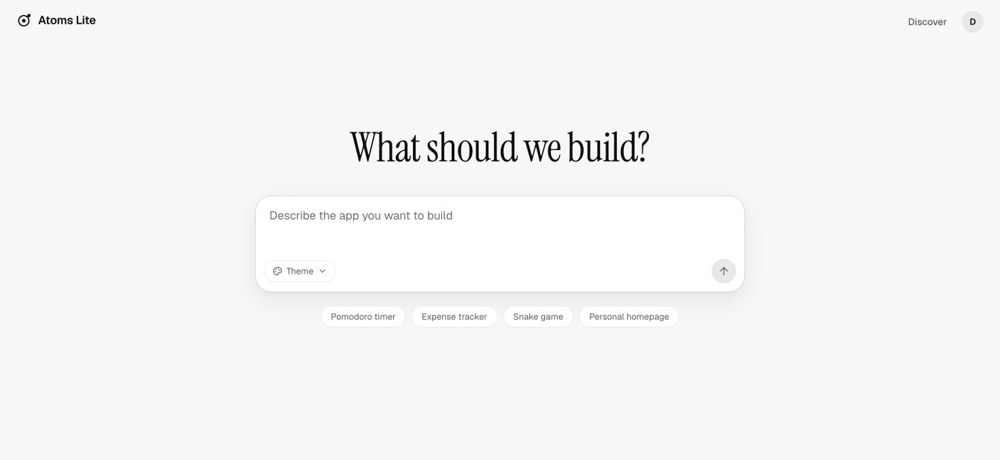

2. 项目列表：主要入口可用，重名项目较多。

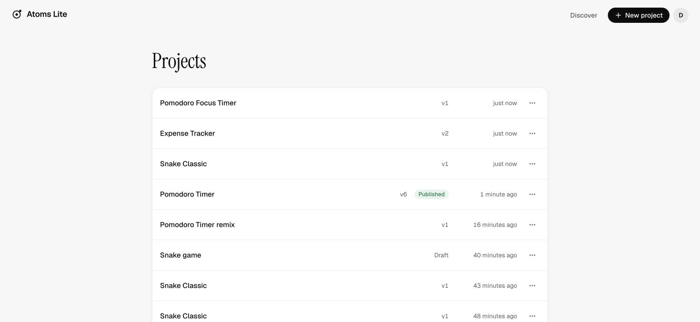

3. 桌面 Preview：基本可用，分栏固定。

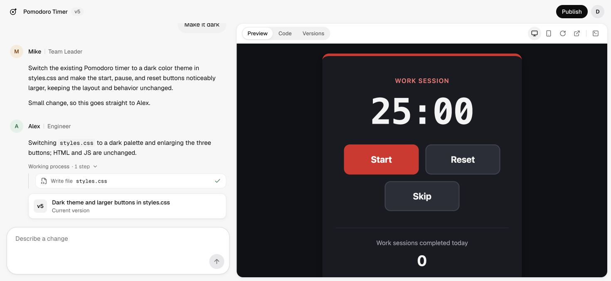

4. Code / Versions：外框本轮保持一致，但阅读状态不连续。

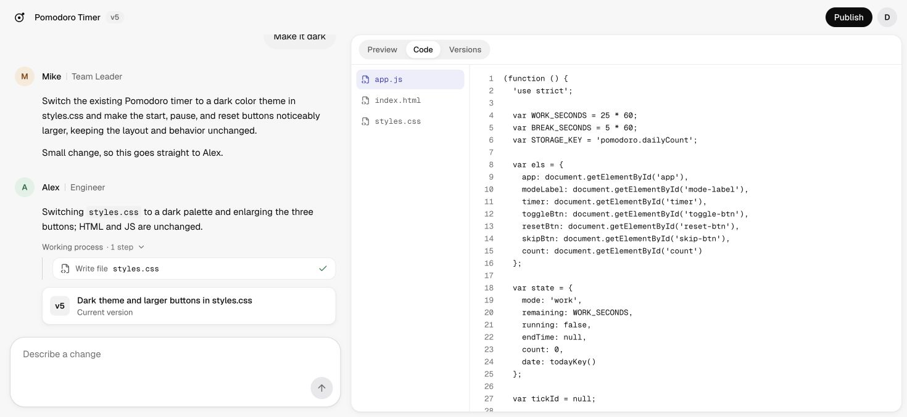
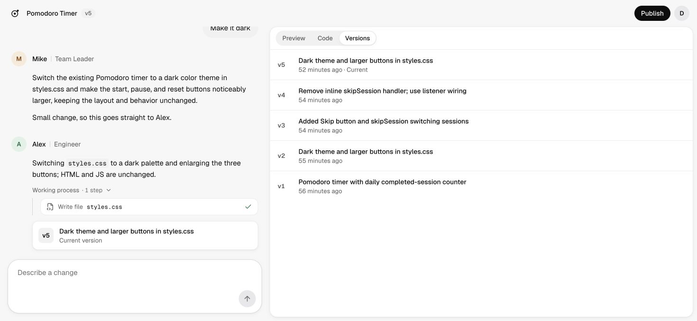

5. 窄桌面：工具栏出现实际裁切。

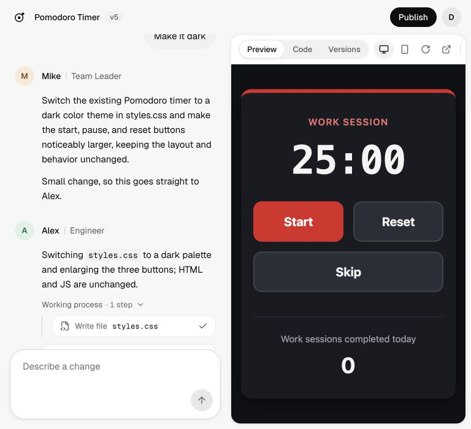

6. 手机 Preview / Code：预览基本可用，Code 文件栏占宽过大。

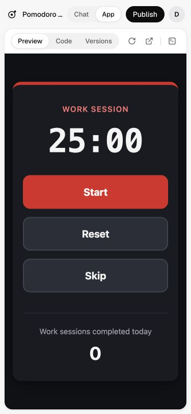
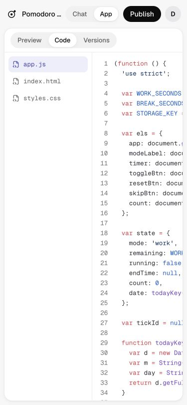

7. Console：可打开关闭，固定占高需改进。

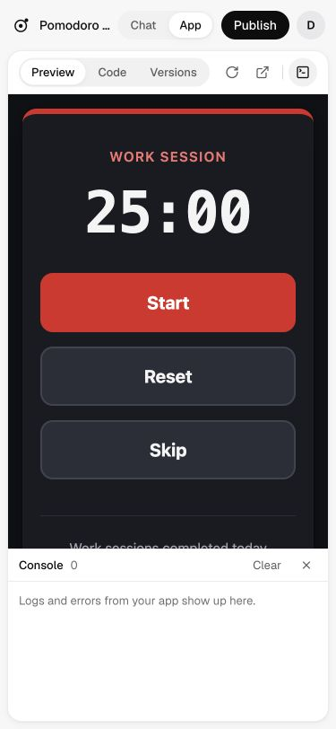

8. 历史与发布弹窗：历史加载未成功；弹窗能看清版本并取消。

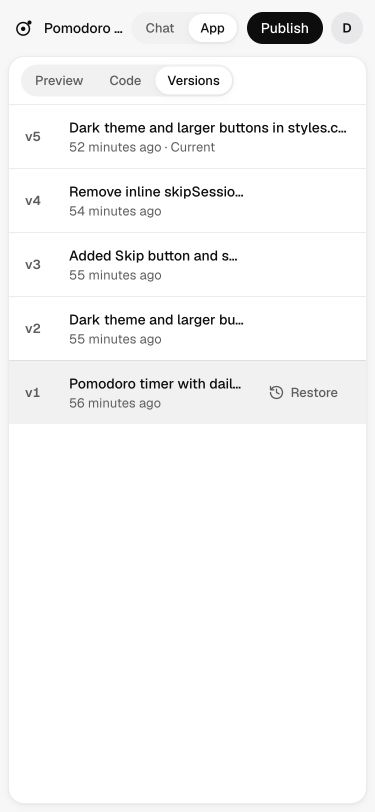
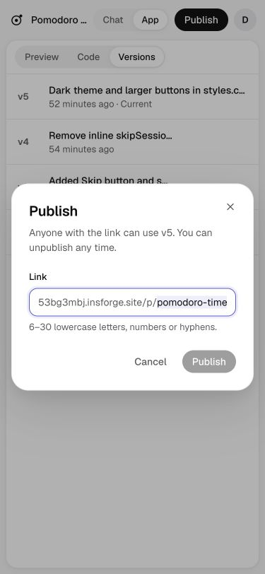

9. 阅读位置：第 59 行切换标签后回到第 1 行。

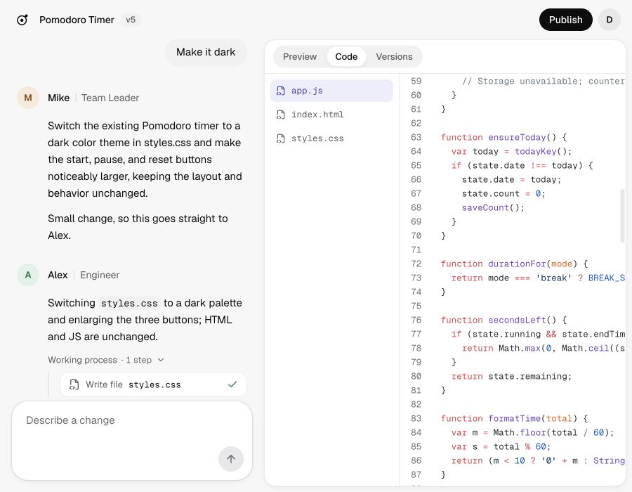
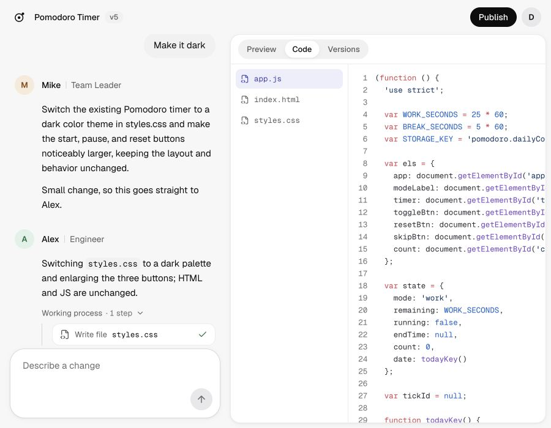

10. 多行输入：两行窗口内滚动，缺少自动增长。

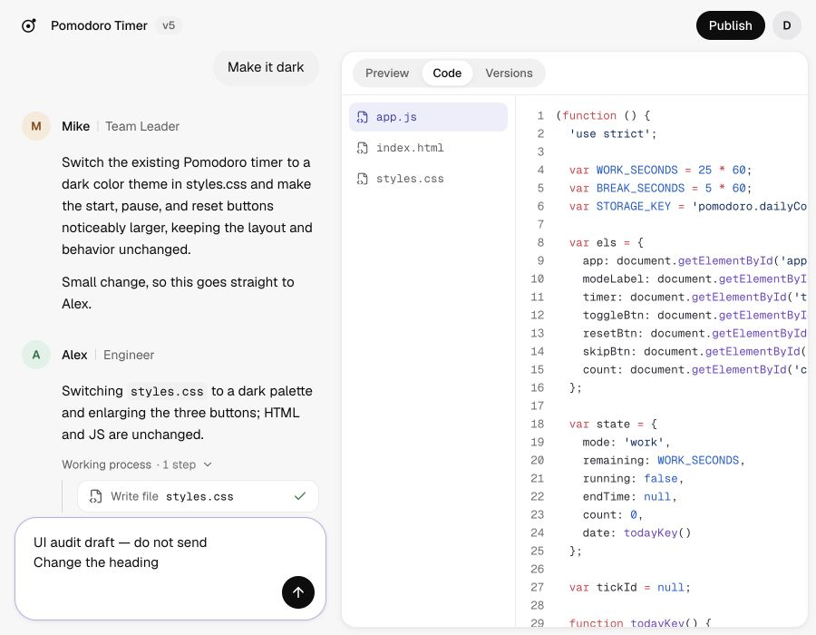
